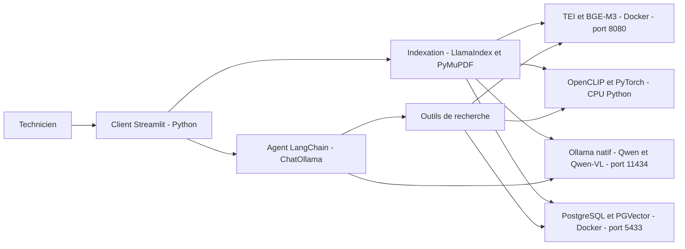
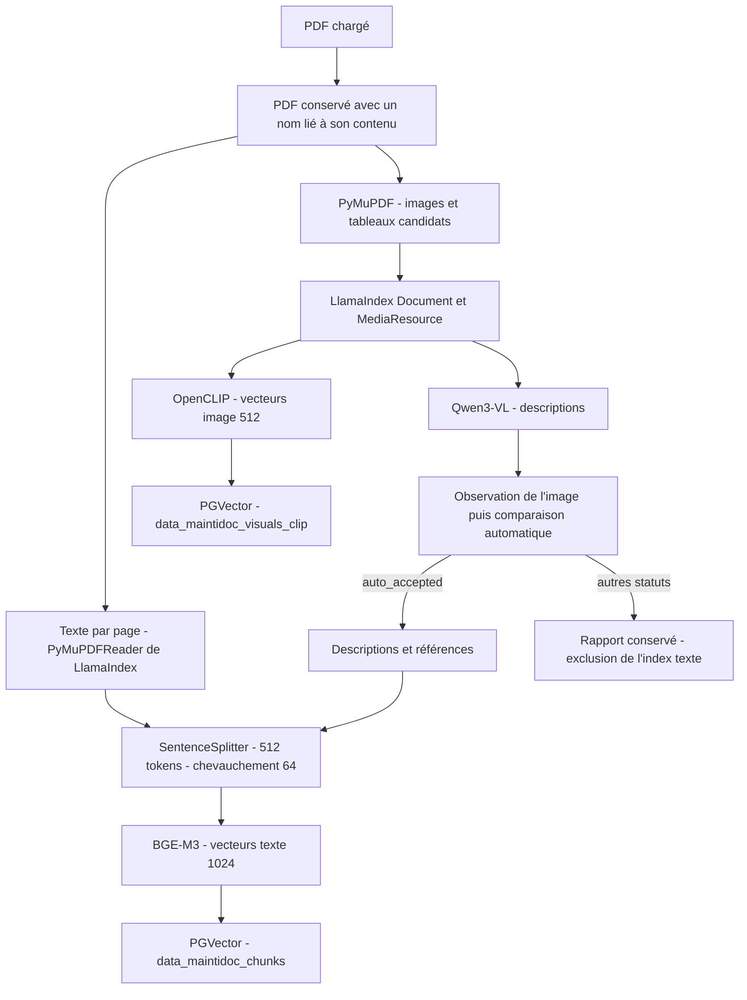
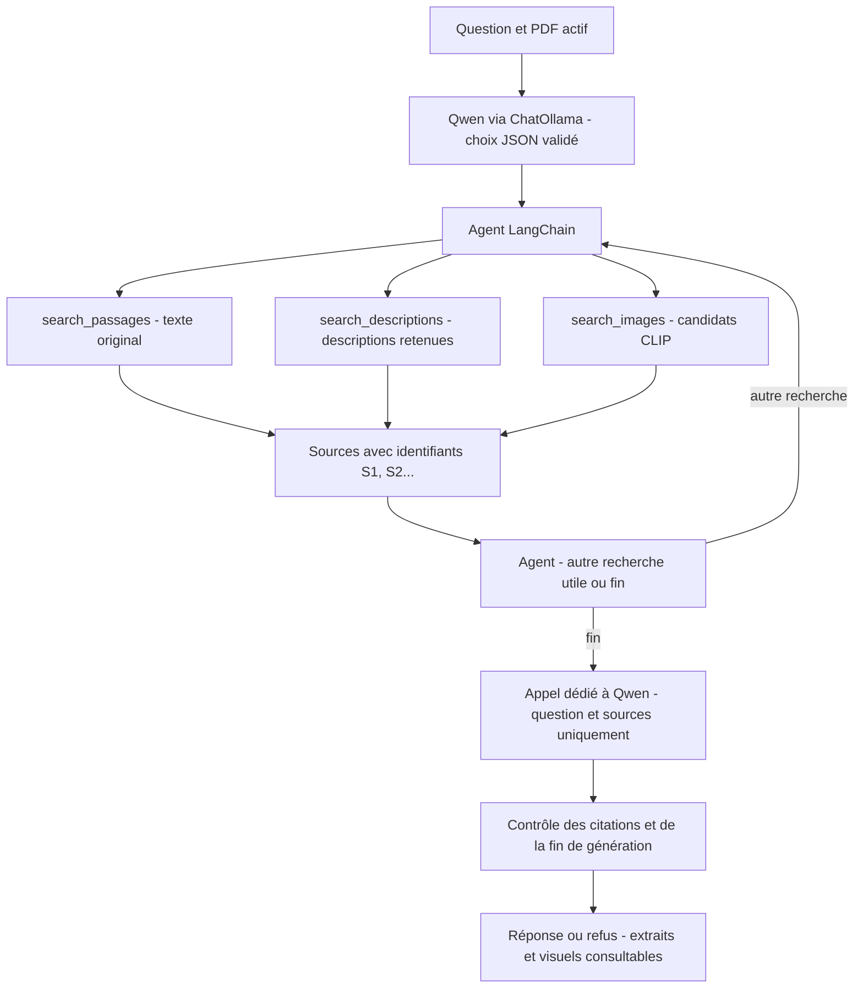

# MaintiDoc — architecture de l'étape 1

## Composants exécutés

Streamlit appelle les fonctions Python directement. Les API HTTP appartiennent
à TEI et à Ollama ; nous n'avons pas ajouté de serveur FastAPI.

## Flux d'indexation

Les tableaux sont conservés sous forme de cellules JSON et de captures PNG.
Leur texte est également présent dans les passages des pages du PDF. Leurs
captures sont indexées par CLIP et les descriptions retenues par BGE. La
reconstruction exacte des cellules complexes n'est pas garantie.

`scripts/ingest_pdf.py` enchaîne les scripts déjà écrits. Un manifeste conserve
les empreintes des entrées, du code et des sorties. Une reprise réutilise les
étapes inchangées ; les étapes de stockage sont toujours revérifiées pour
permettre de repeupler une base recréée. Les identifiants des nœuds évitent les
doublons lorsque les mêmes enregistrements sont réimportés.

## Flux de question-réponse

Le filtre du PDF actif est imposé par le code dans les outils. Le modèle ne
choisit pas le périmètre documentaire. Les scores BGE et CLIP ne sont pas
mélangés : ils appartiennent à deux espaces vectoriels distincts.

L'agent conserve au maximum six sources et effectue au maximum quatre
recherches réussies. La boucle possède aussi une limite de récursion. Les
appels d'outils d'une question sont sérialisés. Les quatre derniers messages
de conversation, limités en taille, servent à résoudre les questions de suivi.
Ils ne sont pas transmis comme preuves à la génération finale.

## Fichiers à lire

| Fonction | Fichier |
| --- | --- |
| Interface | `app.py` |
| Enchaînement de l'indexation | `scripts/ingest_pdf.py` |
| Agent, outils et génération finale | `scripts/agent.py` |
| Recherche BGE / CLIP | `scripts/search_chunks.py` / `scripts/search_visuals.py` |
| Catalogue et références locales | `scripts/library.py` |
| Contrôle automatique des descriptions | `scripts/auto_check_descriptions.py` |
