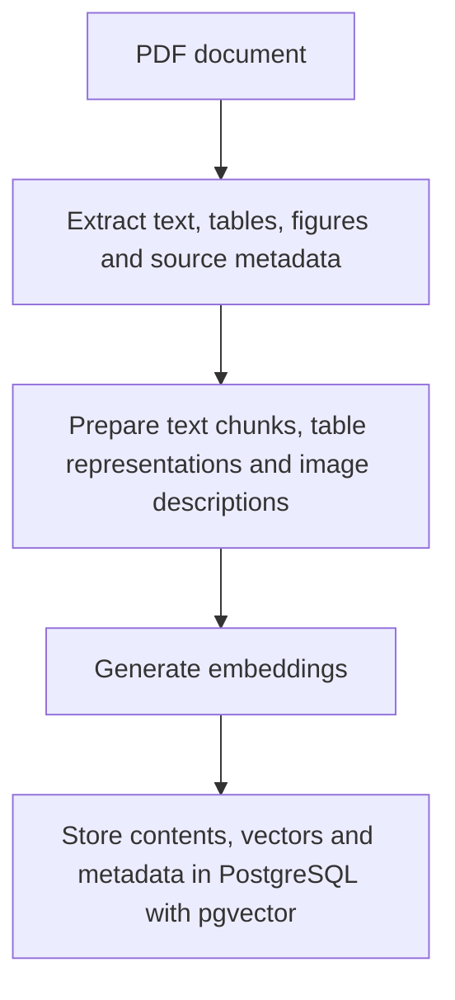

# Document Indexing Pipeline

## Purpose

Prepare PDF contents for retrieval while preserving references
to the original document and pages.

## Proposed pipeline

## Processing principles

- Split text into passages that remain linked to their source pages.
- Preserve table headers and relationships between rows and columns.
- Generate image descriptions using a vision-language model.
- Generate text embeddings for passages, tables and image descriptions.
- Generate CLIP embeddings for figures.
- Keep text and CLIP vectors in separate vector spaces.
- Retain original PDFs and extracted figures for source consultation.

## Status

Proposed design. Implementation has not started.